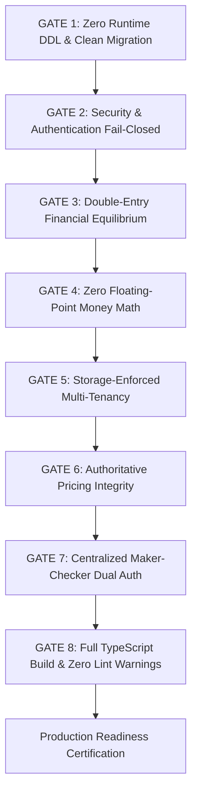

# iTrip Enterprise ERP — Acceptance Criteria & Quality Gates (Phase 3)

**Platform:** iTrip / Firuzo Unified Travel & Commerce Operating System  
**Document:** Definition of Done (DoD), Verification Protocols & Quality Gates  
**Version:** 2.0.0-ENTERPRISE  
**Enforcement Authority:** Enterprise QA & Solution Architecture Team

---

## 1. Quality Gates (Go / No-Go Criteria)

---

## 2. Granular Acceptance Criteria per Gate

### GATE-01: Zero Runtime DDL & Clean Migration
- **Verification Rule:** `grep -rn "ensureDatabaseSchemaHealed" src/` must yield 0 matches.
- **Verification Rule:** Database bootstrapping must succeed using `prisma migrate deploy` exclusively against a blank PostgreSQL database.
- **Verification Rule:** Database user credentials for production web containers must not possess `ALTER TABLE`, `DROP TABLE`, or `CREATE TABLE` permissions.

### GATE-02: Security & Authentication Fail-Closed
- **Verification Rule:** Every administrative server action must invoke `requirePermission()` or equivalent session validation.
- **Verification Rule:** Automated security test must verify that an anonymous request (`!session`) in test/staging/production environments returns HTTP 401/403.
- **Verification Rule:** No hardcoded email strings (e.g. `admin@firuzo.com`) can override relational RBAC permissions in `middleware.ts` or server actions.

### GATE-03: Double-Entry Financial Equilibrium
- **Verification Rule:** Trial balance query across any valid date range must satisfy:
  $$\left|\sum \text{Debit} - \sum \text{Credit}\right| < 10^{-6}$$
- **Verification Rule:** Database unique constraint on `LedgerEntry(groupId)` must reject duplicate submissions of the same transaction group.
- **Verification Rule:** Attempting to post a journal entry where $\sum \text{Debit} \neq \sum \text{Credit}$ must throw `FinancialImbalanceException` and leave the database unmodified.

### GATE-04: Zero Floating-Point Money Math
- **Verification Rule:** In all monetary calculation files (`pricing`, `checkout`, `ledger`, `tax-engine`), no monetary variables may be typed as JavaScript `number` or calculated using float operators.
- **Verification Rule:** All monetary columns in `prisma/schema.prisma` must be defined as `Decimal @db.Decimal(18, 4)` (or `Int` rials where specified in the Business vertical).

### GATE-05: Storage-Enforced Multi-Tenancy
- **Verification Rule:** An automated test authenticating as B2B Agency A attempting to fetch or mutate an order/invoice belonging to B2B Agency B must be blocked with an HTTP 403 / `TenantAccessDeniedError`.
- **Verification Rule:** Global search queries executed by an agency user must never return entities where `organizationId` is NULL or belongs to another organization.

### GATE-06: Authoritative Pricing Integrity
- **Verification Rule:** `BookingApplicationService` must never return a hardcoded numeric fallback (e.g. `85,000,000 IRR`) or an unindexed static array item (`TOURS[0]`).
- **Verification Rule:** A booking creation request lacking a verified dynamic quote or valid `itemId` must fail immediately with an `UnpricedItemError`.

### GATE-07: Centralized Maker-Checker Dual Authorization
- **Verification Rule:** For any refund or settlement exceeding configured thresholds, the user performing the approval (`checkerId`) cannot match the requesting user (`makerId`).
- **Verification Rule:** Attempting to approve one's own request must trigger an exception and record an unauthorized elevation attempt in `AuditLog`.

### GATE-08: Build, Static Analysis & Automated E2E
- **Verification Rule:** `pnpm run typecheck` (`tsc --noEmit`) must exit with code 0.
- **Verification Rule:** `pnpm run lint` must exit with 0 errors and 0 warnings.
- **Verification Rule:** Playwright E2E suites for the 16 golden paths (customer registration, booking, payment, journal posting, refund, settlement, agency isolation) must pass cleanly.
