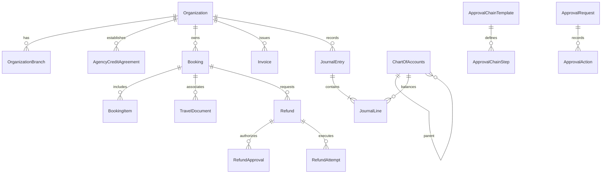

# iTrip Enterprise ERP — Database Design & Schema Evolution (Phase 3)

**Platform:** iTrip / Firuzo Unified Travel & Commerce Operating System  
**Document:** Database Schema Evolution, Entity-Relationship Models & Migration Strategy  
**Version:** 2.0.0-ENTERPRISE  
**Database Engine:** PostgreSQL 17  
**ORM Tooling:** Prisma ORM 5.22.0  
**Schema Governance Policy:** Strict migration files (`prisma/migrations/*`). Zero runtime DDL.

---

## 1. Schema Evolution Principles

1. **Storage-Enforced Multi-Tenancy:**
   All newly created ERP tables must include `organizationId` and declare composite uniqueness constraints:
   `@@unique([organizationId, id])`
   Child tables must link via composite foreign keys:
   `@@relation(fields: [organizationId, parentId], references: [organizationId, id])`
2. **Numeric Precision Discipline:**
   - Monetary amounts: `Decimal @db.Decimal(18, 4)`
   - Foreign exchange rates: `Decimal @db.Decimal(12, 6)`
   - Percentages & tax rates: `Decimal @db.Decimal(5, 4)`
   - Prohibited types: `Float`, JavaScript number approximations.
3. **Audit Trail Completeness:**
   Every transactional table must record:
   - `createdAt DateTime @default(now())`
   - `updatedAt DateTime @updatedAt`
   - `createdById String?` (Maker ID)
   - `organizationId String` (Tenant ID)
4. **No Free-Form String State Machines:**
   All new status fields must be constrained via check constraints or dedicated lookup tables to eliminate untyped string drift.

---

## 2. Entity-Relationship Diagrams (Target Core)



---

## 3. Detailed Model Definitions (Prisma Schema Additions)

### 3.1 Chart of Accounts & General Ledger Hardening
```prisma
model ChartOfAccounts {
  id              String             @id @default(cuid())
  code            String             @unique // e.g. "1020", "2010"
  nameFa          String             // Persian account title
  nameEn          String             // English account title
  type            String             // "ASSET", "LIABILITY", "EQUITY", "REVENUE", "EXPENSE"
  parentId        String?
  parent          ChartOfAccounts?   @relation("AccountHierarchy", fields: [parentId], references: [id])
  children        ChartOfAccounts[]  @relation("AccountHierarchy")
  isActive        Boolean            @default(true)
  isFrozen        Boolean            @default(false)
  currency        String             @default("IRR")
  journalLines    JournalLine[]
  createdAt       DateTime           @default(now())
  updatedAt       DateTime           @updatedAt

  @@index([type])
  @@index([parentId])
}

// Hardening existing JournalLine model
// Adds composite index for trial balance aggregation performance
// @@index([chartOfAccountId, createdAt])
```

### 3.2 Accounts Receivable (AR) & Credit Management
```prisma
model AgencyCreditAgreement {
  id              String       @id @default(cuid())
  organizationId  String       @unique
  organization    Organization @relation(fields: [organizationId], references: [id], onDelete: Cascade)
  creditLimit     Decimal      @default(0) @db.Decimal(18, 4)
  usedCredit      Decimal      @default(0) @db.Decimal(18, 4)
  paymentTerms    String       @default("NET_15") // NET_7, NET_15, NET_30
  status          String       @default("ACTIVE") // ACTIVE, SUSPENDED, DELINQUENT
  reviewDate      DateTime?
  createdAt       DateTime     @default(now())
  updatedAt       DateTime     @updatedAt

  @@index([status])
}
```

### 3.3 Centralized Maker-Checker Approval Workflow
```prisma
model ApprovalRequest {
  id              String           @id @default(cuid())
  organizationId  String
  resourceType    String           // "REFUND", "SETTLEMENT", "CREDIT_LIMIT", "JOURNAL_REVERSAL"
  resourceId      String           // Target entity ID
  makerId         String           // Request initiator
  status          String           @default("PENDING") // PENDING, APPROVED, REJECTED, EXPIRED
  amount          Decimal?         @db.Decimal(18, 4)
  currency        String?          @default("IRR")
  reason          String
  slaExpiresAt    DateTime
  actions         ApprovalAction[]
  createdAt       DateTime         @default(now())
  updatedAt       DateTime         @updatedAt

  @@unique([organizationId, id])
  @@index([status, slaExpiresAt])
  @@index([resourceType, resourceId])
}

model ApprovalAction {
  id              String          @id @default(cuid())
  requestId       String
  request         ApprovalRequest @relation(fields: [requestId], references: [id], onDelete: Cascade)
  checkerId       String          // Approving/Rejecting user
  decision        String          // "APPROVED", "REJECTED"
  comments        String?
  signatureHash   String?         // Cryptographic audit proof
  createdAt       DateTime        @default(now())

  @@index([requestId])
  @@index([checkerId])
}
```

### 3.4 Secure Document Vault
```prisma
model SecureDocument {
  id              String       @id @default(cuid())
  organizationId  String
  entityType      String       // "PASSPORT", "NATIONAL_ID", "CONTRACT", "SUPPLIER_INVOICE"
  entityId        String
  fileName        String
  mimeType        String
  fileSize        Int
  checksumSha256  String
  storageKey      String       // Encrypted vault key
  accessLevel     String       @default("CONFIDENTIAL") // PUBLIC, INTERNAL, CONFIDENTIAL, RESTRICTED
  expiresAt       DateTime?
  uploadedById    String
  createdAt       DateTime     @default(now())
  updatedAt       DateTime     @updatedAt

  @@unique([organizationId, id])
  @@index([entityType, entityId])
}
```

---

## 4. Performance & High-Frequency Indexing Strategy

1. **Trial Balance Fast Aggregation Index:**
   `CREATE INDEX idx_journal_lines_coa_created ON journal_lines (chart_of_account_id, created_at) INCLUDE (debit, credit);`
2. **Deterministic Idempotency Key Indices:**
   `CREATE UNIQUE INDEX idx_ledger_entries_group_id ON ledger_entries (group_id) WHERE group_id IS NOT NULL;`
   `CREATE UNIQUE INDEX idx_crypto_receipts_tx_hash ON crypto_payment_receipts (tx_hash) WHERE tx_hash IS NOT NULL;`
3. **Outbox Polling Index:**
   `CREATE INDEX idx_outbox_events_unprocessed ON outbox_events (available_at, retry_count) WHERE status = 'PENDING';`
