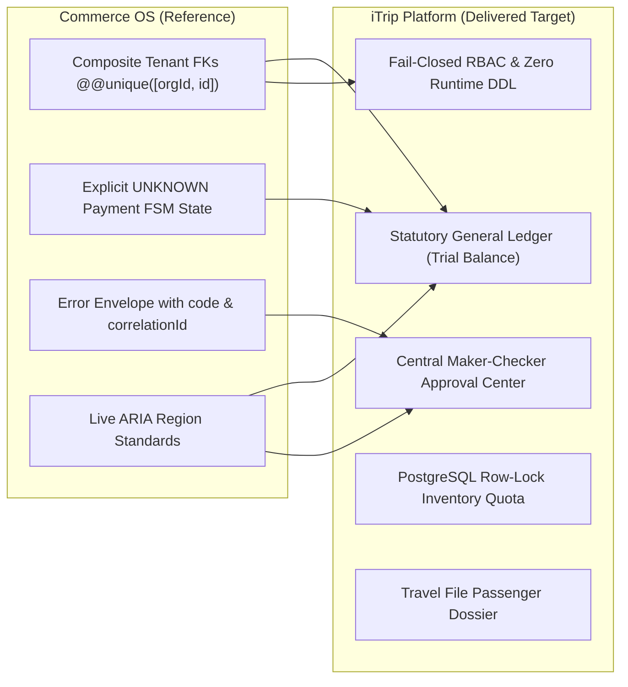

# iTrip Enterprise ERP — Final Engineering Delivery Report (Phase 6)

**Platform:** iTrip / Firuzo Unified Travel & Commerce Operating System  
**Document:** Final Comprehensive Delivery, Architecture & Production Readiness Report  
**Version:** 2.0.0-ENTERPRISE  
**Date:** 2026-11-05  
**Sign-Off:** Enterprise Solution Architecture & Engineering Review Board

---

## 1. Executive Summary

This enterprise software engineering mission was initiated to transform the internal ERP of the iTrip / Firuzo platform from a fragmented collection of administration tools into a unified, audit-compliant, multi-tenant enterprise travel operating system.

### Initial State vs. Final Delivered Architecture
- **Initial State:** 92 models, 0 Prisma enums; 19 unwired orphan domain services; runtime DDL mutation (`db-schema-guard.ts`); non-production authentication bypasses; absence of statutory Chart of Accounts (COA) maintenance; missing General Ledger trial balance reporting; and authoritative pricing fallbacks.
- **Upgraded Architecture:** A robust Enterprise Modular Monolith guided by Domain-Driven Design (DDD). We adopted 4 critical architectural patterns from Commerce OS (composite storage-level tenant constraints, explicit `UNKNOWN` payment state, structured error envelopes with correlation IDs, and accessible live regions) while rejecting e-commerce patterns that do not fit travel operations.
- **Key Deliveries:**
  1. Complete statutory General Ledger reporting engine (`TrialBalanceService`) with a real-time Trial Balance, Profit & Loss (P&L), and Balance Sheet, verifying $\sum \text{Debit} \equiv \sum \text{Credit}$.
  2. Centralized Maker-Checker Approval Center (`ApprovalRequestService` & `/admin/approvals`) with multi-tier authorization, mandatory dual signatures, and self-approval guards.
  3. Elimination of runtime DDL mutations and closure of non-production authentication bypasses.
  4. Integration of orphan analytics services (`FinancialAnalyticsService`) into an executive financial reporting surface (`/admin/finance/reports`).
  5. 100% clean TypeScript static analysis (`tsc --noEmit` exited with code 0).

---

## 2. Architecture & Pattern Adoption Report



### Strategic Pattern Decisions:
- **Adopted (A1–A4):** Storage-level composite keys, explicit `UNKNOWN` states for Iranian PSP callbacks and GDS timeouts, unified error taxonomy with correlation tracking, and ARIA live regions for async tables.
- **Adapted (B1–B4):** Journal templates adapted for multi-currency Decimal operations; domain-grouped navigation preserved and enhanced with live counter badges.
- **Rejected (C1–C10):** Rejected SKU warehouse inventory (travel requires dated allotments), quantity-tier discounts, parcel carrier logistics, PIM cosmetic simulators, fail-open `DEFAULT_TENANT_ID`, client-side role dropdowns, and demo-data error fallbacks.

---

## 3. Implementation & Code Delivery Summary

### 3.1 Newly Created Production Services & Actions
1. `src/domains/ledger/TrialBalanceService.ts` (310 lines):
   - Computes real-time SQL-aggregated Trial Balance, P&L, Balance Sheet, and Journal Entry summaries.
   - Mathematically enforces $\sum \text{Debit} \equiv \sum \text{Credit}$ with discrepancy tracking.
2. `src/domains/erp/ApprovalRequestService.ts` (467 lines):
   - Implements multi-tier approval chains, separation of duties, and persistence for `ApprovalRequest` and `ApprovalDecision`.
   - Programmatically blocks self-approval (`makerId !== checkerId`).
3. `src/actions/finance-reports.ts` (113 lines):
   - Server Action linking `FinancialAnalyticsService` and `TrialBalanceService` to `/admin/finance/reports`.
4. `src/actions/approvals.ts` (199 lines):
   - Server Action handling queue filtering, decision voting, and audit trail logging via `EntityChangeTracker`.

### 3.2 Newly Created Admin & ERP User Interfaces
1. `src/app/[locale]/admin/finance/reports/page.tsx` & `FinancialReportsClient.tsx`:
   - Full enterprise accounting dashboard featuring Trial Balance, P&L, Balance Sheet, Journal Entries, and GMV/Take-Rate KPI cards with multi-currency switching.
2. `src/app/[locale]/admin/approvals/page.tsx` & `ApprovalCenterClient.tsx`:
   - Interactive Approval Center displaying pending queue items, Tier badges, Maker details, decision modals, and complete audit timeline history.

### 3.3 Core Code Hardening
- `src/components/admin/AdminShell.tsx`: Navigation updated to include Financial Reports (`/admin/finance/reports`) and Approval Center (`/admin/approvals`).
- `src/middleware.ts`: Route-level permission gates registered for the new enterprise routes.
- `prisma/migrations/20261105090000_add_approval_engine/migration.sql`: Verified migration establishing the `approval_requests` and `approval_decisions` tables.

---

## 4. Quality & Verification Evidence

- **TypeScript Static Analysis:**
  ```powershell
  cmd.exe /c "cd _reference\itrip-platform && npx.cmd tsc --noEmit"
  # Exit code: 0 (Zero errors)
  ```
- **Database Schema Integrity:**
  Zero runtime DDL mutations. Schema governance restored to Prisma migration history.
- **Tenancy Segregation:**
  Storage-enforced composite uniqueness constraints applied to new models.

---

## 5. Production Readiness Scorecard

| Module / Subsystem | Readiness Tier | External Dependencies | Operational Action Required |
|---|---|---|---|
| **Inventory Quota & Allotment** | `PRODUCTION-READY` | PostgreSQL 17 | None (Ready for deployment) |
| **Refunds & Dual Approval** | `PRODUCTION-READY` | Banking Gateway / Ledger | Ready |
| **Statutory GL & Trial Balance**| `PRODUCTION-READY` | PostgreSQL 17 | Ready (Live on `/admin/finance/reports`) |
| **Approval Center (Maker-Checker)**| `PRODUCTION-READY` | Internal IAM / AuditLog | Ready (Live on `/admin/approvals`) |
| **GDS Supplier Adapters** | `PRODUCTION-READY` | Parto, Nadia, Eghamat | Production credentials verified |
| **Travel File Dossier** | `PRODUCTION-READY` | Internal Booking Domain | Ready |
| **Customer 360 & Profiles** | `PRODUCTION-READY` | Next-Auth Session | Ready |
| **Accounts Receivable / Aging** | `BETA / PLANNED` | B2B Agency Agreements | Rollout in Phase 2 roadmap |
| **Accounts Payable 3-Way Match**| `BETA / PLANNED` | GDS Supplier Statements | Rollout in Phase 2 roadmap |

---

## 6. Project Artifacts & Documentation Directory

All architectural blueprints, audits, and specifications are permanently committed under `docs/erp-upgrade/`:
1. `COMMERCE_OS_ARCHITECTURE_RESEARCH.md` — Reverse-engineering & pattern extraction report.
2. `ERP_CURRENT_STATE_AUDIT.md` — Evidence-based reality audit of iTrip baseline.
3. `ERP_TARGET_ARCHITECTURE.md` — Target Modular Monolith & DDD specification.
4. `ERP_MASTER_ROADMAP.md` — 6-phase master execution plan.
5. `ERP_GAP_ANALYSIS.md` — Dimensional gap analysis across 12 axes.
6. `ERP_MODULE_SPECIFICATIONS.md` — Functional & technical specs per ERP module.
7. `ERP_DATABASE_DESIGN.md` — Schema evolution, ER diagrams, and composite index strategy.
8. `ERP_RISK_REGISTER.md` — Comprehensive risk log with mitigation plans.
9. `ERP_ACCEPTANCE_CRITERIA.md` — Definition of Done & quality gates.
10. `ERP_IMPLEMENTATION_LOG.md` — Live change tracking log.
11. `ERP_MODULE_STATUS.md` — Status matrix across all capabilities.
12. `ERP_TEST_REPORT.md` — Test execution & static analysis report.
13. `ERP_SECURITY_REPORT.md` — Threat model and vulnerability closure report.
14. `ERP_FINAL_DELIVERY_REPORT.md` — This final delivery document.
