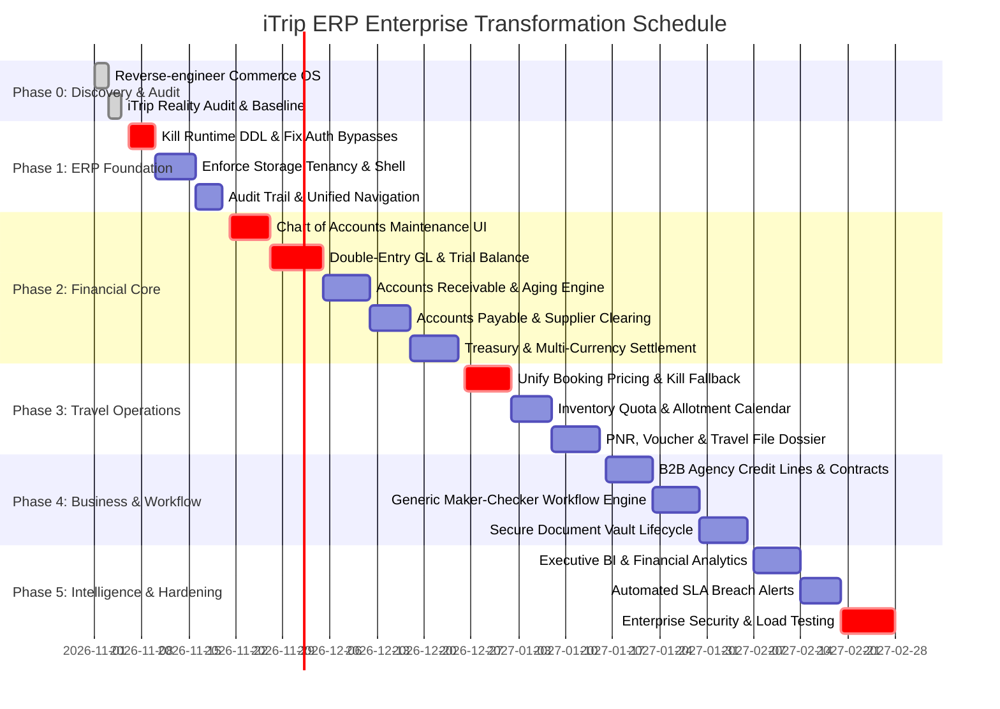

# iTrip Enterprise ERP — Master Roadmap & Execution Plan (Phase 3)

**Platform:** iTrip / Firuzo Unified Travel & Commerce Operating System  
**Document:** Master Engineering Roadmap & Implementation Sequencing  
**Version:** 2.0.0-ENTERPRISE  
**Execution Methodology:** Incremental DDD Delivery with Zero Production Regression  
**Priority Tiers:**
- **P0 (Critical / Blocker):** Security holes, runtime DDL, financial inaccuracies, broken tenancy.
- **P1 (High / Foundation):** General Ledger, Chart of Accounts, AR/AP, AuditLog console.
- **P2 (Medium / Operations):** Central Workflow approval engine, B2B agency credit line automation.
- **P3 (Growth / Intelligence):** Executive BI dashboards, SLA analytics, AI copilot.

---

## 1. Phased Master Timeline

---

## 2. Phase-by-Phase Detailed Specifications

### Phase 0: Discovery, Reverse-Engineering & Reality Audit (COMPLETED)
- **Status:** `DONE`
- **Deliverables:**
  - `docs/erp-upgrade/COMMERCE_OS_ARCHITECTURE_RESEARCH.md` (Reverse-engineered analysis of reference monorepo).
  - `docs/erp-upgrade/ERP_CURRENT_STATE_AUDIT.md` (Evidence-based baseline audit of 92 models, 27 admin routes, and 26 action modules).
- **Key Finding:** iTrip's inventory and refund engines are superior to commerce-os; priority is wiring orphan code, fixing DDL/auth holes, and building the missing statutory accounting core.

---

### Phase 1: ERP Foundation & Security Hardening
**Objective:** Eliminate critical security bypasses, dismantle dangerous runtime schema mutation, and enforce tenant security.

#### Task 1.1: Retire Runtime Schema Mutation (P0)
- **Current Problem:** `src/lib/db-schema-guard.ts` executes arbitrary DDL on request hot-paths (`ALTER TABLE ... ADD COLUMN`).
- **Target State:** Runtime DDL completely eliminated. All schema evolution governed exclusively by Prisma migration files (`prisma migrate deploy`).
- **Database Changes:** None. Verify all current tables and columns exist in `prisma/schema.prisma`.
- **Backend Changes:** Remove `ensureDatabaseSchemaHealed()` calls across `src/actions/auth.ts`, `src/actions/booking.ts`, `src/domains/booking/BookingApplicationService.ts`, and health check.
- **Acceptance Criteria:** `grep -rn "ensureDatabaseSchemaHealed" src/` returns 0. Database health endpoint verifies schema state passively without altering DDL.

#### Task 1.2: Close Authorization Bypasses & Enforce RBAC (P0)
- **Current Problem:** Non-production environments allow unauthenticated callers (`!session`) to execute CMS mutations and delete system error logs. Middleware contains hardcoded email escalation (`admin@firuzo.com`).
- **Target State:** Fail-closed authentication across all environments. All administrative actions require explicit permissions from relational `UserRole` $\to$ `RolePermission` $\to$ `Permission`.
- **Backend Changes:** Refactor `src/actions/content.ts` and `src/actions/system-logs.ts` to require valid session and `requirePermission()`. Delete email matching in `src/middleware.ts`.
- **Acceptance Criteria:** Unit tests prove anonymous and non-permitted requests return 401/403 across all environment configurations.

#### Task 1.3: Storage-Layer Multi-Tenancy Enforcement (P0)
- **Current Problem:** Tenancy enforced only in 5 actions; 83 models lack tenant columns.
- **Target State:** Composite foreign keys and explicit `organizationId` scoping applied to all agency-facing queries.
- **Database Changes:** Migration adding `organizationId` to `Payment`, `Refund`, and `InvoiceLine` with cascade rules.
- **Acceptance Criteria:** Cross-tenant access tests in `src/domains/identity/tenant-isolation.test.ts` pass with 100% tenant separation.

---

### Phase 2: Statutory Financial & Accounting Core
**Objective:** Transform iTrip's subledger into a full statutory double-entry accounting system with automated Trial Balance, AR/AP, and Treasury management.

#### Task 2.1: Chart of Accounts (COA) Enterprise Management (P1)
- **Current Problem:** `ChartOfAccounts` rows are upserted implicitly on-the-fly from string maps; no management UI exists.
- **Target State:** Full Chart of Accounts hierarchy management (Asset, Liability, Equity, Revenue, Expense) with parent-child codes and account freezing.
- **Backend Changes:** `ChartOfAccountsService` providing `listAccounts()`, `createAccount()`, `updateAccount()`, and `validateAccountInvariants()`.
- **Frontend Changes:** New route `/admin/finance/accounts` featuring tree-view navigation, active balance summaries, and account creation modals.
- **Permissions:** `finance:coa:manage`.
- **Acceptance Criteria:** Cannot delete accounts with non-zero balances. Cannot create unbalanced sub-accounts.

#### Task 2.2: General Ledger & Live Trial Balance Engine (P0)
- **Current Problem:** No Trial Balance, Balance Sheet, or Profit & Loss report. `AccountingExportService` is an unwired orphan.
- **Target State:** Real-time SQL aggregation computing Debit/Credit totals across all accounts for any selected date range and fiscal period.
- **Backend Changes:** `GeneralLedgerService.getTrialBalance(startDate, endDate, currency, organizationId)`.
- **Frontend Changes:** New route `/admin/finance/trial-balance` with Jalali date-picker, currency filter, and export to Sepidar/Excel.
- **Acceptance Criteria:** Trial balance mathematically guarantees $\sum \text{Debit} \equiv \sum \text{Credit}$.

#### Task 2.3: Accounts Receivable (AR) & Aging Subledger (P1)
- **Current Problem:** No automated tracking of unpaid B2B agency invoices or aging buckets.
- **Target State:** Automated AR ledger tracking invoices, payment terms, and aging buckets (0-30, 31-60, 61-90, 90+ days).
- **Backend Changes:** `AccountsReceivableService` with automated overdue alert triggers and agency credit lockouts.
- **Frontend Changes:** New route `/admin/finance/receivables` with aging heatmap and one-click statement generation.
- **Permissions:** `finance:ar:manage`.
- **Acceptance Criteria:** Invoices past due automatically transition to `OVERDUE` status and notify agency account managers.

#### Task 2.4: Accounts Payable (AP) & Supplier Billing Reconciliation (P1)
- **Current Problem:** Supplier settlements are batched manually without three-way reconciliation against GDS booking records.
- **Target State:** Automated reconciliation comparing GDS PNR cost statements against local `BookingItem.netCost` to identify billing discrepancies.
- **Backend Changes:** Wire `three-way-reconciliation.ts` into `SettlementDomainService`.
- **Frontend Changes:** Upgrade `/admin/finance/settlements` with discrepancy highlighting and approval actions.
- **Permissions:** `finance:settlement:execute`.
- **Acceptance Criteria:** Discrepancies exceeding $1\%$ flag an operational exception and require manual supervisor override.

---

### Phase 3: Travel Operations & Integrity Hardening
**Objective:** Eliminate fallback pricing, integrate travel files with supplier PNRs, and standardize allotment inventory management.

#### Task 3.1: Authoritative Pricing Integrity & Float Math Removal (P0)
- **Current Problem:** `BookingApplicationService` falls back to `85,000,000 IRR` when item id is missing. `src/lib/money.ts` uses JavaScript floats.
- **Target State:** Strict fail-closed pricing. Missing items throw `UnpricedItemException`. All checkout calculations use `Prisma.Decimal`.
- **Backend Changes:** Delete float arithmetic in `src/lib/money.ts`. Require mandatory `itemId` in quote generation.
- **Acceptance Criteria:** Zero float calculations in checkout path. Unit tests prove unpriced items fail gracefully without charging customers.

#### Task 3.2: Visual Allotment Quota & Stop-Sell Calendar (P1)
- **Current Problem:** `/admin/inventory` is an unpaginated client component without multi-day batch update capabilities.
- **Target State:** Enterprise calendar view displaying hotel room and tour quotas with bulk stop-sell toggles and hold release controls.
- **Frontend Changes:** Refactor `/admin/inventory` to use server-side pagination and monthly grid layout.
- **Permissions:** `inventory:write`.
- **Acceptance Criteria:** Bulk updates lock affected dates atomically using `InventoryEngine.setAllotmentPolicy()`.

---

### Phase 4: Business Management & Automation
**Objective:** Deliver central Maker-Checker approval workflows, wire document vault, and automate B2B credit policies.

#### Task 4.1: Centralized Maker-Checker Workflow Engine (P1)
- **Current Problem:** `ApprovalChainDomainService` (11.8 KB) is an unwired orphan. Only refunds have maker-checker logic.
- **Target State:** Unified approval engine handling high-value refunds, supplier payouts, credit limit adjustments, and discount overrides.
- **Backend Changes:** Wire `ApprovalChainDomainService` to Server Actions in `src/actions/admin.ts`.
- **Frontend Changes:** New route `/admin/approvals` (Approval Center) displaying pending requests, SLA countdowns, and audit trail.
- **Permissions:** `workflow:approve`.
- **Acceptance Criteria:** Creator cannot approve their own requests. Expired requests escalate to senior supervisors automatically.

#### Task 4.2: Enterprise Document Vault Integration (P2)
- **Current Problem:** `DocumentManagementService` is an unwired orphan; passenger passports and invoices lack versioned secure storage.
- **Target State:** Encrypted document vault with SHA-256 checksum verification, signed download URLs, and access audit logging.
- **Backend Changes:** Wire `DocumentManagementService` into `TravelFileService` and `Customer360Service`.
- **Frontend Changes:** Secure document viewer component with watermarking and download logging.
- **Permissions:** `document:view:sensitive`.
- **Acceptance Criteria:** Sensitive travel documents (passports, national IDs) log every access event in `AuditLog`.

---

### Phase 5: Intelligence, Observability & Hardening
**Objective:** Activate financial analytics BI, deploy automated SLA telemetry, and perform end-to-end load and security audits.

#### Task 5.1: Financial & Executive BI Dashboard (P2)
- **Current Problem:** `FinancialAnalyticsService` and `OperationalSlaAnalyticsService` are fully implemented but unwired.
- **Target State:** Comprehensive Executive BI dashboard displaying real GMV, net take-rate, ledger reconciliation ratio, and queue SLA adherence.
- **Frontend Changes:** New route `/admin/analytics` consuming real analytics domain services.
- **Permissions:** `analytics:view:executive`.
- **Acceptance Criteria:** Numbers derive strictly from verified ledger and booking rows without client-side synthetic mocks.

#### Task 5.2: Enterprise Security & Performance Hardening (P0)
- **Target State:** Zero high-severity vulnerabilities, sub-200ms API response times, and automated disaster recovery verification.
- **Activities:**
  - Automated Playwright E2E suites covering 16 critical golden paths.
  - Verification of database index coverage across high-frequency queries.
  - Elimination of synthetic demo seeders from production administrative builds.
- **Acceptance Criteria:** Production build completes with 0 TypeScript errors, 0 ESLint warnings, and passing E2E suites.
