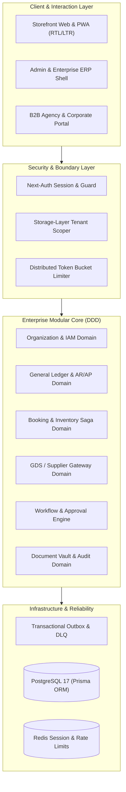
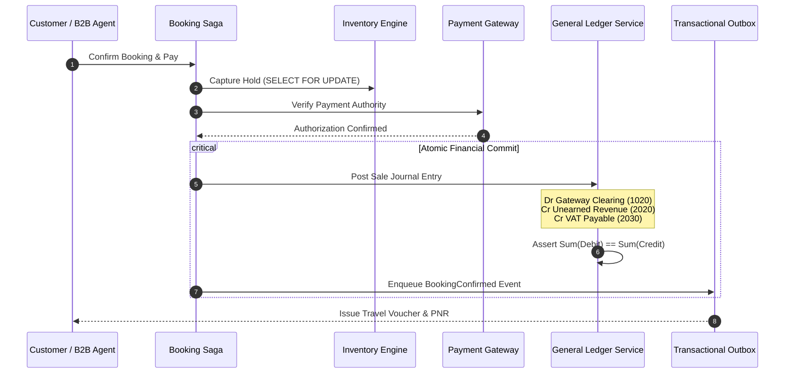
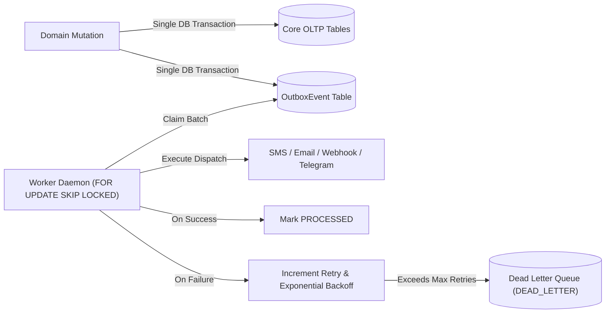

# iTrip Enterprise ERP — Target Architecture (Phase 2)

**Document:** Target System & Enterprise Architecture Specification  
**Platform:** iTrip / Firuzo Unified Travel & Commerce Operating System  
**Version:** 2.0.0-ENTERPRISE  
**Target Completion Horizon:** Production Staged Rollout  
**Architectural Style:** Enterprise Modular Monolith with Domain-Driven Design (DDD)

---

## 1. Architectural Philosophy & Guiding Principles

The target ERP architecture transforms iTrip from a booking-centric monolith with disconnected management tools into a unified, audit-compliant, multi-tenant enterprise travel operating system.

### Core Non-Negotiable Invariants
1. **Double-Entry Financial Integrity:**  
   Every monetary movement must produce balanced journal lines where:
   $$\sum \text{Debit} = \sum \text{Credit}$$
   Direct wallet or balance updates without balanced journal entries are strictly forbidden.
2. **Deterministic Tenancy:**  
   Multi-tenancy must be enforced at the database storage layer using composite primary and foreign keys (`@@unique([organizationId, id])`), preventing cross-tenant leakage at the PostgreSQL constraint level.
3. **No Floating-Point Money Math:**  
   All monetary amounts, taxes, commissions, and foreign exchange conversions must use arbitrary-precision `Prisma.Decimal` (minimum `Decimal(18,4)`), with explicit remainder allocation rules.
4. **State Machine Exclusivity:**  
   Entity transitions (Booking, Payment, Refund, Allotment, Exception) must occur exclusively via typed State Machine guards with recorded transition logs and reason codes.
5. **Separation of Concerns:**  
   Domain logic resides solely within domain services (`src/domains/*`). React components and Next.js Server Actions serve exclusively as presentation, authentication, and orchestration layers.



---

## 2. Domain Decomposition & Bounded Contexts

```
src/domains/
├── organization/       # Organization hierarchy, branches, cost centers, memberships
├── identity/           # RBAC, permissions, session telemetry, staff credentials
├── ledger/             # Statutory GL, Chart of Accounts, Journal entries, Invariants
├── finance/            # AR/AP subledgers, aging, treasury, bank accounts, invoicing
├── payments/           # Gateways, intents, receipts, reconciliations, webhooks
├── refund/             # Refund state machine, maker-checker dual authorization
├── inventory/          # Allotments, calendar quotas, row-lock reservations
├── booking/            # Booking sagas, PNRs, voucher management, price snapshots
├── supplier/           # GDS connectors (Parto, Nadia, Eghamat, eCardo), health, SLA
├── travel-file/        # ERP passenger file dossier, task assignment, documents
├── crm/                # Customer 360, traveler profiles, interaction timeline
├── workflow/           # Generic approval chain, escalation rules, SLA engine
├── document/           # Secure document vault, versioning, checksums, access logs
└── analytics/          # Financial BI, GMV/take-rate, operational queue telemetry
```

---

## 3. Financial & Accounting Architecture

### 3.1 Two-Tier General Ledger Hierarchy
The target financial system maintains a strict separation between customer/agent operational balances and statutory General Ledger reporting:

1. **Tier 1: Operational Subledger (`Account` & `LedgerEntry`)**
   - Micro-level transaction records for user wallets, agency credit lines, and supplier pre-funding.
   - Enforces unique transaction grouping via `@@unique([groupId])`.
   - Records multi-currency amounts alongside reference base currency (`IRR` / `TOMAN`) and exchange rate snapshot (`fxRate`).
2. **Tier 2: Statutory General Ledger (`ChartOfAccounts`, `JournalEntry`, `JournalLine`)**
   - Macro-level enterprise accounting adhering to Iranian and international accounting standards.
   - 5-Tier Account Structure:
     - `1000 - Assets` (Current Assets, Bank Accounts, Gateway Clearing, Accounts Receivable)
     - `2000 - Liabilities` (Accounts Payable, Supplier Escrow, Unearned Revenue, VAT Payable)
     - `3000 - Equity` (Retained Earnings, Owner Capital)
     - `4000 - Revenue` (Flight Ticket Revenue, Hotel Booking Margin, Tour Commission)
     - `5000 - Expenses` (GDS Supplier Costs, Gateway Processing Fees, Referral Commissions)

### 3.2 Double-Entry Journal Posting Flow


### 3.3 Accounts Receivable (AR) & Accounts Payable (AP) Engine
- **AR Subledger:** Tracks agency invoices, payment terms (Net 7, Net 15, Net 30), credit limits, and automated Aging Buckets:
  - `Current (0-30 days)`
  - `Past Due (31-60 days)`
  - `Delinquent (61-90 days)`
  - `Default (> 90 days - Automatic Booking Lockout)`
- **AP Subledger:** Reconciles supplier GDS booking confirmations against monthly billing statements. Calculates supplier withholding tax, commercial discounts, and net disbursement amounts.

### 3.4 Multi-Currency Precision & FX Management
- Supported Standard Currencies: `IRR` (Iranian Rial), `TOMAN` (Persian Toman), `USD`, `EUR`, `AED`, `USDT`.
- Explicit Currency Model:
  $$\text{Base Amount (IRR)} = \text{Foreign Amount} \times \text{FX Rate}$$
- Remainder Allocation Protocol: When dividing quotes or splitting payments across passengers, the integer remainder is assigned to the primary adult ticket to prevent fraction leakage.

---

## 4. Organizational & Tenancy Architecture

### 4.1 Storage-Level Tenant Isolation
To replace application-only tenancy checks, the target architecture introduces physical composite uniqueness constraints across all operational models:
```prisma
model Organization {
  id              String   @id @default(cuid())
  code            String   @unique
  name            String
  taxId           String?
  creditLimit     Decimal  @default(0) @db.Decimal(18, 4)
  availableCredit Decimal  @default(0) @db.Decimal(18, 4)
  // Relations
  branches        OrganizationBranch[]
  bookings        Booking[]
}

model OrganizationBranch {
  id              String   @id @default(cuid())
  organizationId  String
  code            String
  name            String
  // Composite unique constraint
  @@unique([organizationId, code])
}
```

### 4.2 Role-Based Access Control (RBAC) & Scope Hierarchy
Granular permission structure across 4 operational tiers:
1. **System Administrator (`SUPER_ADMIN`):** Platform-wide configuration, database health, global financial reconciliation.
2. **Headquarters Staff (`HQ_OPERATOR`, `HQ_FINANCE`, `HQ_SUPERVISOR`):** Cross-agency exception remediation, settlement batch approvals, supplier contract configuration.
3. **Agency Manager (`AGENCY_OWNER`, `AGENCY_ADMIN`):** Branch creation, agent user onboarding, agency credit line monitoring, agency-level bookings.
4. **Counter Agent (`TRAVEL_AGENT`):** Creating booking drafts, issuing tickets within assigned credit allowance, customer profile management.

---

## 5. Operations, Workflow & Reliability Architecture

### 5.1 Generic Workflow & Approval Engine
A centralized Maker-Checker approval service supporting:
- **Approval Chains:** Sequential or parallel multi-tier authorization.
- **Dynamic Routing Rules:** Route by threshold (e.g., refunds $> 50,000,000\text{ IRR}$ require Finance Manager; $> 200,000,000\text{ IRR}$ require Director).
- **Self-Approval Prevention:** The initiating agent cannot approve their own requests.
- **SLA Breach Escalation:** Automated notification and re-routing when a ticket remains pending beyond configured time limit.

### 5.2 Transactional Outbox & Reliable Message Broker


---

## 6. Enterprise ERP User Experience & Design System

### 6.1 Unified Enterprise Shell (`AdminShell`)
- **Header:** Global Search (`Ctrl+K`), Organization/Branch context switcher, Currency Selector, Notifications Drawer, User Profile menu.
- **Navigation:** Grouped, permission-filtered collapsible sidebar with live counter badges:
  - *میز کار عملیات (Operations Workbench):* Exceptions, Travel Files, Passenger Manifests.
  - *رزرو و موجودی (Bookings & Inventory):* Flights, Hotels, Tours, Allotments, Sniper Rules.
  - *مدیریت مالی و حسابداری (Financial Management):* General Ledger, Invoices, Settlements, Offline Receipts.
  - *تأمین‌کنندگان و قراردادها (Suppliers & Contracts):* GDS Connectors, Health Monitoring.
  - *سازمان و دسترسی‌ها (Organization & IAM):* Agencies, Branches, Staff, Customer 360.
  - *سیستم و لاگ‌ها (System & Observability):* Audit Logs, Error Tracking, System Settings.

### 6.2 Data Table Standards (`EnterpriseDataTable`)
Every tabular view in the target ERP must provide:
- **Server-Side Pagination & Cursor Navigation** (Default 25/50/100 rows).
- **Column Sorting & Visual Direction Indicators.**
- **Advanced Filtering Drawer:** Filter by Date Range (Jalali & Gregorian), Status, Organization, Currency, Amount.
- **Bulk Action Bar:** Batch approval, status update, CSV/Excel export.
- **Live Empty & Loading Skeletons with ARIA accessibility compliance.**

### 6.3 Persian Typography & RTL/LTR Bidirectionality
- Typography: Vazirmatn font family with tabular numerals (`tnum`) for monetary and numerical columns.
- Dual Calendar Support: Jalali (`1405/08/15`) as primary display with ISO Gregorian fallback tooltip.
- Contrast Compliance: WCAG 2.2 AA compliant contrast ratio ($\ge 4.5:1$).
